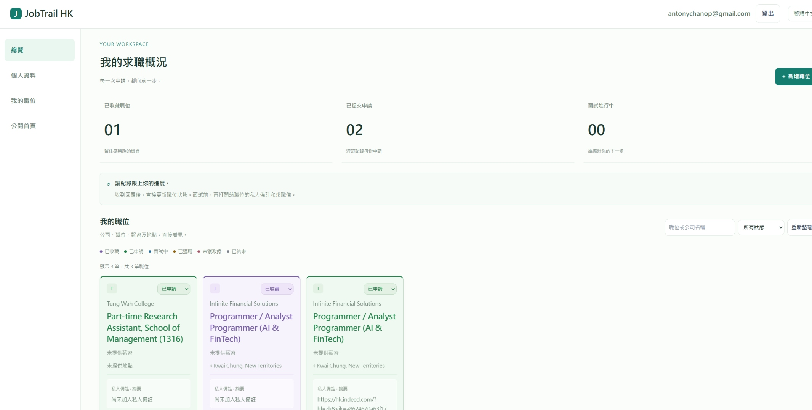
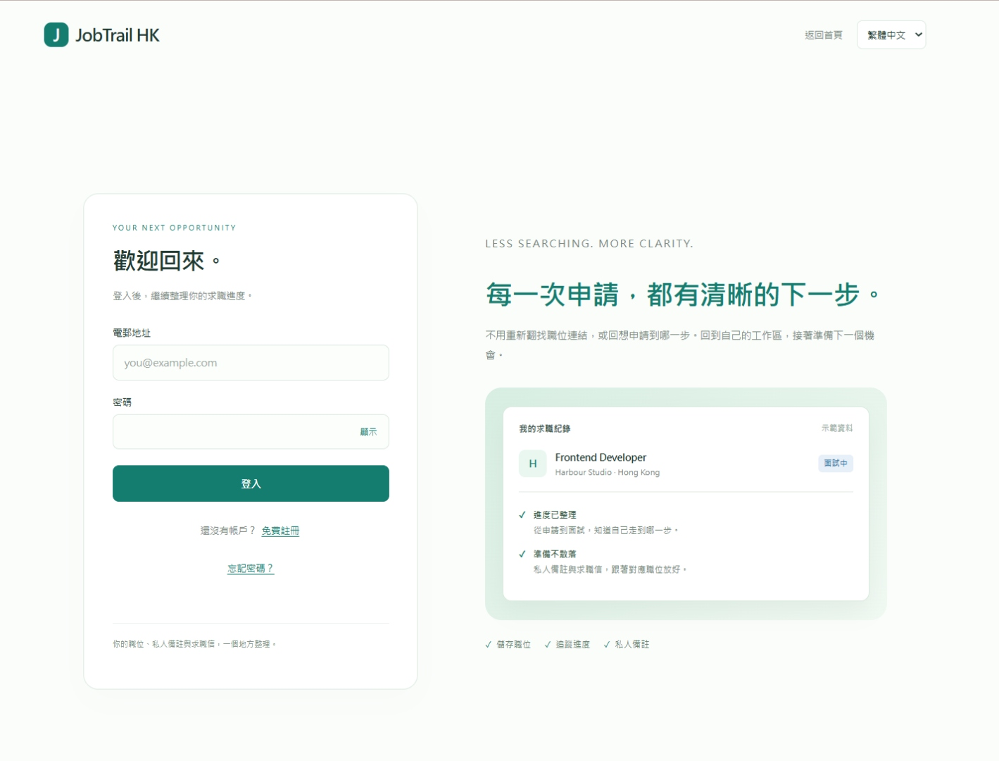
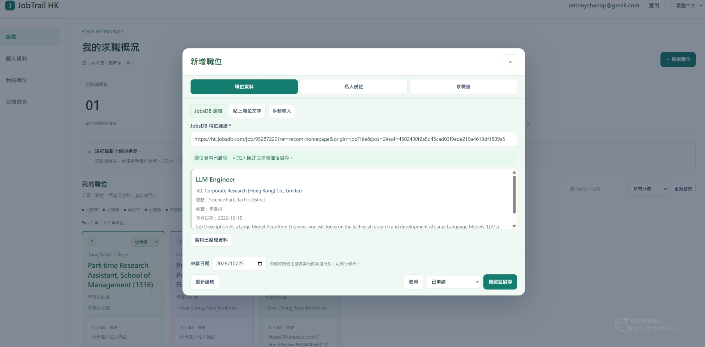
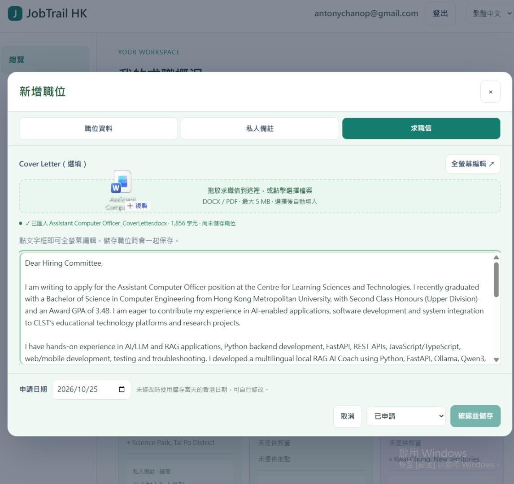
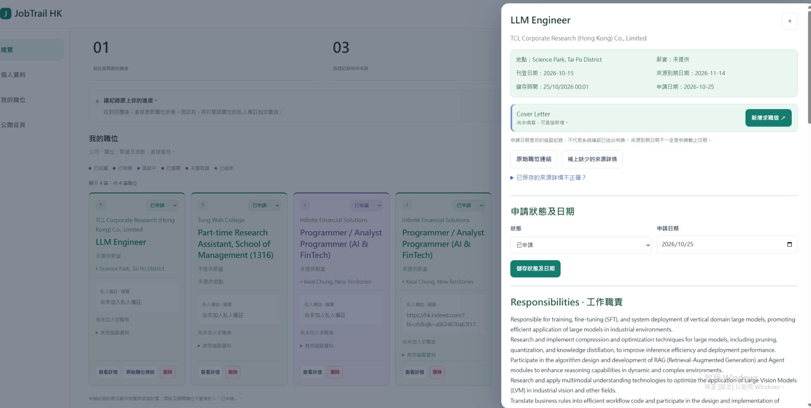

# JobTrail HK

[開啟 JobTrail HK](https://jobtrail-hk-staging.onrender.com/) — 本網站部署於 Render，閒置後首次開啟可能需要約 30 秒啟動，實際等待時間可能更長，請耐心等候。

[觀看示範影片](https://drive.google.com/drive/folders/1zx7pNfILYH_sVez3zgMnXvwCoiXmWpQd?usp=sharing) — 了解如何使用 JobTrail HK 匯入職位、管理求職信及追蹤申請進度。
## 繁體中文

### 關於專案

JobTrail HK 是為香港求職者而設的求職申請管理工具，而不是招聘網站。將不同招聘平台找到的職位集中整理，追蹤申請進度，並把私人備註及求職信與相應職位放在一起。

### 網站啟動時間

本網站部署於 Render。閒置後首次開啟，有時需要約 30 秒啟動，實際等待時間可能更長。若頁面尚未顯示，請稍候再試。

### 主要功能

- 註冊帳戶、驗證電郵及登入個人工作區。
- 手動新增職位，或使用支援的招聘連結／貼上職位文字預覽匯入資料。
- 集中查看公司、職位、薪資、地點及申請狀態。
- 搜尋職位並按狀態篩選。
- 為職位保存私人備註及求職信。
- 匯入 DOCX／PDF 求職信文字，並使用全螢幕編輯。
- 查看職位詳情、更新申請日期及狀態，或刪除個別職位紀錄。

### 使用方法

1. 開啟網站；如正在啟動，請稍候。
2. 免費註冊，按驗證電郵內的連結完成驗證，再登入。
3. 按「新增職位」，選擇 JobsDB 連結、貼上職位文字或手動輸入。
4. 匯入後先核對職位、公司、薪資及地點；補上或修正資料後再儲存。
5. 如有需要，在「私人備註」加入備註，並在「求職信」輸入文字，或拖放／選擇 DOCX 或 PDF 檔案匯入。檔案上限為 5 MB；匯入後請核對文字，需要時可全螢幕編輯。
6. 選擇狀態及申請日期，按「確認並儲存」。求職信內容會隨職位一同儲存。
7. 在「我的職位」使用搜尋及狀態篩選找回紀錄；按「查看詳情」查看職責及其他資料，並在收到回覆後更新狀態及日期。

狀態包括：已收藏、已申請、面試中、已獲聘、未獲取錄及已結束；毋須依序經過每個階段。

匯入功能不會代你向僱主提交申請，申請日期只用作個人追蹤。來源到期日期不一定是申請截止日期。招聘網站可能限制讀取；如連結匯入失敗，可改用貼上職位文字或手動輸入。

### 畫面預覽

#### 求職總覽

#### 我的職位

#### 登入頁面

#### 職位連結匯入

#### 求職信匯入與編輯

#### 職位詳情及申請進度

---

## English

[Try JobTrail HK](https://jobtrail-hk-staging.onrender.com/) — Hosted on Render. The first visit after a period of inactivity may take around 30 seconds to load, sometimes longer. Thank you for your patience.

[Watch the demo video](https://drive.google.com/drive/folders/1zx7pNfILYH_sVez3zgMnXvwCoiXmWpQd?usp=sharing) — See how to import job listings, manage cover letters, and track application progress with JobTrail HK.

### About

JobTrail HK is a job application tracker for Hong Kong job seekers, not a job board. Organise opportunities found across recruitment platforms, track application progress, and keep private notes and cover letters alongside each role.

### Website start-up time

The website is hosted on Render. The first visit after a period of inactivity may take around 30 seconds to start, and the actual wait can be longer. If the page has not appeared yet, please wait and try again.

### Key features

- Register an account, verify your email, and sign in to your workspace.
- Add jobs manually or preview imported details from supported job links or pasted listing text.
- View companies, roles, salaries, locations, and application statuses in one place.
- Search jobs and filter by status.
- Keep private notes and cover letters with each role.
- Import cover-letter text from DOCX or PDF files and edit in full-screen mode.
- View job details, update application dates and statuses, or delete individual records.

### How to use

1. Open the website and allow time for it to start if needed.
2. Register for a free account, verify your email using the link sent to you, and sign in.
3. Select the add-job button, then choose a JobsDB link, pasted listing text, or manual entry.
4. Review imported details before saving. Correct any mistakes and fill in missing fields, including the role, company, salary, and location where available.
5. Optionally add private notes and enter a cover letter. You can also drag and drop or select a DOCX or PDF file up to 5 MB to import its text. Review the result and use full-screen editing if needed.
6. Choose a status and application date, then confirm and save. Cover-letter content is saved with the job.
7. Find records in your jobs list using search and status filters. Open job details to review responsibilities and other information, and update the status and date after receiving a response.

Available statuses are saved, applied, interview, offer, rejected, and closed. You do not need to move through every stage in order.

Importing a listing does not submit an application to the employer, and the application date is only a personal tracking record. A source listing's expiry date is not necessarily the application deadline. Recruitment sites may restrict access; if link import fails, try pasting the listing text or entering details manually.

### Screenshots

#### Application dashboard

#### My jobs

#### Sign-in page

#### Job link import

#### Cover-letter import and editing

#### Job details and application tracking

